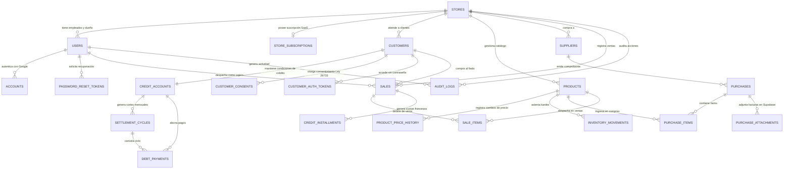

# Quina - Esquema de base de datos relacional PostgreSQL

Este documento especifica el modelo entidad-relación y el esquema físico DDL
completo para la base de datos PostgreSQL de **Quina** sobre Supabase.
Implementa aislamiento multi-inquilino (*multi-tenant*), seguridad a nivel de
fila (*Row Level Security - RLS*), tipos de datos numéricos exactos para
cálculos financieros y trazabilidad inmutable mediante kardex y bitácora de
auditoría.

El capítulo correspondiente para el informe académico formal bajo normas APA 7
se encuentra en:
- Código fuente del capítulo: [`report/chapters/40-database/41-database-model.md`](../../report/chapters/40-database/41-database-model.md)
- Informe compilado en PDF: [`build/informe-base-de-datos-quina.pdf`](../../build/informe-base-de-datos-quina.pdf)

Para consultar la arquitectura general de la aplicación, revisa la
[documentación de la webapp](quina-webapp-documentation.md).

---

## 1. Principios de diseño de base de datos

El diseño del esquema sigue las mejores prácticas de ingeniería de datos y los
estándares de la industria para sistemas financieros y comerciales:

1. **Aislamiento multi-inquilino (*Multi-tenancy*):** cada tabla operativa
   incluye la columna `store_id UUID NOT NULL` como clave foránea con
   restricción estricta (`ON DELETE RESTRICT`). Las políticas de RLS garantizan
   que ningún comercio pueda leer o alterar datos de otro comercio.
2. **Identificadores universales (UUIDv7 / UUIDv4):** las claves primarias
   utilizan `UUID` generado mediante `gen_random_uuid()`, evitando la exposición
   de identificadores secuenciales en URLs y APIs públicas.
3. **Precisión numérica exacta para finanzas:**
   - Montos monetarios y saldos: `NUMERIC(12, 2)` con validación `CHECK (amount >= 0)`
     para evitar desbordamientos de coma flotante y representar importes hasta
     S/ 9,999,999,999.99.
   - Cantidades de inventario: `NUMERIC(10, 3)` para admitir fracciones de tres
     decimales (kilos, gramos, litros).
   - Tasas de interés nominales y efectivas: `NUMERIC(7, 4)` (ejemplo: `0.0500`
     representa 5.0000 % o tasa mensual de 0.001667).
4. **Marcas de tiempo con zona horaria:** todas las columnas temporales utilizan
   `TIMESTAMPTZ` normalizado en tiempo universal coordinado (UTC).
5. **Inmutabilidad contable y financiera:** los registros de ventas, pagos,
   movimientos de kardex e historial de precios no se actualizan ni se eliminan;
   cualquier corrección operativa se asienta mediante transacciones de ajuste.
6. **Estrategia de indexación compuesta:** se configuran índices compuestos
   encabezados por `store_id` para garantizar tiempos de respuesta inferiores a
   5 milisegundos en el plan gratuito de Supabase.

---

## 2. Diagrama entidad-relación (ERD)

El siguiente diagrama ilustra las entidades principales y sus relaciones a
través de los Bounded Contexts de Quina:



### 2.1. Delimitación de tablas por Bounded Context

La persistencia de Quina se descompone en cinco Bounded Contexts según el diseño estratégico de Domain-Driven Design (DDD). Cada contexto delimita un modelo de dominio coherente, segregando las **entidades principales** (Aggregate Roots y entidades cardinales del negocio) de las **tablas auxiliares de soporte**:

| Bounded Context | Tipo de Dominio | Entidades Principales | Tablas Auxiliares de Soporte | Total |
| :--- | :--- | :--- | :--- | :---: |
| **IAM & Multi-Tenancy** | Genérico / Soporte | `stores`, `users` | `store_subscriptions`, `accounts`, `email_verifications`, `password_reset_tokens` | 6 |
| **Credit & Settlement** | Núcleo (*Core Domain*) | `customers`, `credit_accounts`, `settlement_cycles`, `credit_installments`, `debt_payments` | `customer_consents`, `customer_auth_tokens` | 7 |
| **Catalog & Procurement** | Soporte (*Supporting*) | `products`, `inventory_movements` | `units`, `categories`, `product_price_history`, `suppliers`, `purchases`, `purchase_items`, `purchase_attachments` | 9 |
| **Sales & POS** | Operativo (*Generic*) | `sales`, `sale_items` | — | 2 |
| **Audit & Analytics** | Gobierno (*Supporting*) | `audit_logs` | `ai_recommendation_quotas` | 2 |
| **Total Global** | — | **12 entidades principales** | **14 tablas auxiliares** | **26** |

---

## 3. Diccionario de datos y especificación de tablas

A continuación se detalla la estructura física de cada tabla dividida por
dominio de negocio.

### 3.1. Dominio de Identidad, Tienda y Seguridad

Este módulo gestiona los comercios (*tenants*), el control de acceso basado en
roles (RBAC), la autenticación segura, Google OAuth 2.0, OTP y los tokens de
recuperación.

#### Tabla `stores`
Almacena los datos fiscales y comerciales de cada tienda registrada.

| Columna | Tipo | Restricciones | Descripción |
| :--- | :--- | :--- | :--- |
| `id` | UUID | PK, DEFAULT `gen_random_uuid()` | Identificador único de la tienda. |
| `commercial_name` | VARCHAR(150) | NOT NULL | Nombre comercial visible (ej. "Bodega Don Lucho"). |
| `business_turn` | VARCHAR(50) | NOT NULL | Giro del negocio (bodega, botica, panadería, etc.). |
| `tax_id_type` | VARCHAR(10) | NOT NULL, CHECK in ('RUC', 'DNI') | Tipo de documento fiscal del titular. |
| `tax_id_number` | VARCHAR(15) | NOT NULL, UNIQUE | Número de RUC (11 dígitos) o DNI (8 dígitos). |
| `owner_full_name` | VARCHAR(150) | NOT NULL | Nombre completo del comerciante titular. |
| `contact_email` | VARCHAR(150) | NOT NULL, UNIQUE | Correo principal para notificaciones de cuenta. |
| `contact_phone` | VARCHAR(20) | NULL | Número telefónico o WhatsApp de contacto. |
| `address` | TEXT | NULL | Dirección física de la tienda. |
| `tax_regime` | VARCHAR(30) | NOT NULL, DEFAULT 'NUEVO_RUS' | Régimen tributario peruano (NUEVO_RUS, RER, MYPE). |
| `rus_category` | SMALLINT | NOT NULL, DEFAULT 1, CHECK (1..2) | Categoría del Nuevo RUS (1: hasta S/ 5,000; 2: S/ 8,000). |
| `is_active` | BOOLEAN | NOT NULL, DEFAULT TRUE | Estado operativo de la tienda. |
| `created_at` | TIMESTAMPTZ | NOT NULL, DEFAULT NOW() | Fecha de alta en la plataforma. |
| `updated_at` | TIMESTAMPTZ | NOT NULL, DEFAULT NOW() | Fecha de última actualización de datos. |

#### Tabla `store_subscriptions`
Gestiona el estado de monetización SaaS de cada tienda.

| Columna | Tipo | Restricciones | Descripción |
| :--- | :--- | :--- | :--- |
| `id` | UUID | PK, DEFAULT `gen_random_uuid()` | Identificador de la suscripción. |
| `store_id` | UUID | NOT NULL, UNIQUE, FK `stores(id)` ON DELETE RESTRICT | Tienda titular de la suscripción. |
| `plan_tier` | VARCHAR(20) | NOT NULL, DEFAULT 'CASERO', CHECK in ('CASERO', 'BODEGA_PRO', 'NEGOCIO_PLUS') | Plan contratado. |
| `status` | VARCHAR(20) | NOT NULL, DEFAULT 'ACTIVE', CHECK in ('ACTIVE', 'PAST_DUE', 'CANCELED') | Estado de facturación. |
| `mp_preapproval_id`| VARCHAR(100) | NULL | Identificador de suscripción en Mercado Pago. |
| `current_period_start` | TIMESTAMPTZ | NOT NULL, DEFAULT NOW() | Inicio del periodo de facturación actual. |
| `current_period_end` | TIMESTAMPTZ | NOT NULL | Fin del periodo contratado. |
| `cancel_at_period_end` | BOOLEAN | NOT NULL, DEFAULT FALSE | Indica si la suscripción no se renovará al vencer. |
| `created_at` | TIMESTAMPTZ | NOT NULL, DEFAULT NOW() | Fecha de creación del registro. |
| `updated_at` | TIMESTAMPTZ | NOT NULL, DEFAULT NOW() | Fecha de actualización del estado de pago. |

#### Tabla `users`
Contiene las credenciales y perfiles de los usuarios del sistema.

| Columna | Tipo | Restricciones | Descripción |
| :--- | :--- | :--- | :--- |
| `id` | UUID | PK, DEFAULT `gen_random_uuid()` | Identificador del usuario. |
| `store_id` | UUID | NULL, FK `stores(id)` ON DELETE RESTRICT | Tienda asignada (NULL para Platform Admin). |
| `email` | VARCHAR(150) | NOT NULL, UNIQUE | Correo electrónico principal. |
| `password_hash` | VARCHAR(255) | NULL | Hash de contraseña segura (Argon2id / bcrypt). NULL si usa OAuth. |
| `full_name` | VARCHAR(150) | NOT NULL | Nombres y apellidos completos. |
| `phone` | VARCHAR(20) | NULL | Teléfono móvil. |
| `role` | VARCHAR(20) | NOT NULL, CHECK in ('PLATFORM_ADMIN', 'STORE_OWNER', 'STORE_EMPLOYEE', 'CUSTOMER') | Rol para control de accesos RBAC. |
| `is_email_verified`| BOOLEAN | NOT NULL, DEFAULT FALSE | Indica si el correo fue validado por código OTP. |
| `is_active` | BOOLEAN | NOT NULL, DEFAULT TRUE | Estado de habilitación de la cuenta. |
| `failed_login_attempts` | SMALLINT | NOT NULL, DEFAULT 0 | Contador de fallos de login para política anti-fuerza bruta. |
| `locked_until` | TIMESTAMPTZ | NULL | Marca temporal hasta la que la cuenta está bloqueada (15 min). |
| `last_login_at` | TIMESTAMPTZ | NULL | Fecha y hora del último acceso exitoso. |
| `created_at` | TIMESTAMPTZ | NOT NULL, DEFAULT NOW() | Fecha de registro. |
| `updated_at` | TIMESTAMPTZ | NOT NULL, DEFAULT NOW() | Fecha de modificación. |

#### Tabla `accounts` (Proveedores OAuth 2.0 / Google)
Soporta el inicio de sesión federado mediante Google Cloud Identity.

| Columna | Tipo | Restricciones | Descripción |
| :--- | :--- | :--- | :--- |
| `id` | UUID | PK, DEFAULT `gen_random_uuid()` | Identificador del vínculo OAuth. |
| `user_id` | UUID | NOT NULL, FK `users(id)` ON DELETE CASCADE | Usuario propietario del perfil. |
| `provider` | VARCHAR(30) | NOT NULL, DEFAULT 'google' | Proveedor de identidad externa. |
| `provider_account_id` | VARCHAR(150) | NOT NULL | Identificador único emitido por Google (`sub`). |
| `access_token` | TEXT | NULL | Token de acceso OAuth para llamadas a API de perfil. |
| `refresh_token` | TEXT | NULL | Token de refresco de OAuth. |
| `expires_at` | BIGINT | NULL | Expiración del token en epoch UNIX. |
| `created_at` | TIMESTAMPTZ | NOT NULL, DEFAULT NOW() | Fecha de vinculación de la cuenta. |

> Restricción única: `UNIQUE(provider, provider_account_id)`.

#### Tabla `email_verifications` (Códigos OTP)
Gestiona la verificación de correos electrónicos mediante códigos numéricos de 6 dígitos.

| Columna | Tipo | Restricciones | Descripción |
| :--- | :--- | :--- | :--- |
| `id` | UUID | PK, DEFAULT `gen_random_uuid()` | Identificador del registro OTP. |
| `email` | VARCHAR(150) | NOT NULL | Correo electrónico en proceso de verificación. |
| `otp_hash` | VARCHAR(64) | NOT NULL | Hash SHA-256 del código numérico de 6 dígitos. |
| `attempts` | SMALLINT | NOT NULL, DEFAULT 0 | Intentos fallidos ingresados (máximo 5). |
| `expires_at` | TIMESTAMPTZ | NOT NULL | Expiración del código (15 minutos tras emisión). |
| `verified_at` | TIMESTAMPTZ | NULL | Fecha y hora en que se validó exitosamente. |
| `created_at` | TIMESTAMPTZ | NOT NULL, DEFAULT NOW() | Fecha de despacho del código por Resend. |

#### Tabla `password_reset_tokens`
Almacena tokens seguros de un solo uso para restablecimiento de contraseñas olvidadas.

| Columna | Tipo | Restricciones | Descripción |
| :--- | :--- | :--- | :--- |
| `id` | UUID | PK, DEFAULT `gen_random_uuid()` | Identificador del token. |
| `user_id` | UUID | NOT NULL, FK `users(id)` ON DELETE CASCADE | Usuario que solicitó el restablecimiento. |
| `token_hash` | VARCHAR(64) | NOT NULL, UNIQUE | Hash criptográfico SHA-256 del token enviado en URL. |
| `expires_at` | TIMESTAMPTZ | NOT NULL | Expiración del enlace (30 minutos tras envío). |
| `used_at` | TIMESTAMPTZ | NULL | Fecha y hora de consumo del token (un solo uso). |
| `ip_address` | VARCHAR(45) | NULL | Dirección IP solicitante para auditoría. |
| `created_at` | TIMESTAMPTZ | NOT NULL, DEFAULT NOW() | Fecha de generación del enlace de rescate. |

#### Tabla `customer_auth_tokens` (Magic Links y Acceso sin Contraseña)
Permite a los clientes vecinos ingresar a su estado de cuenta en un toque.

| Columna | Tipo | Restricciones | Descripción |
| :--- | :--- | :--- | :--- |
| `id` | UUID | PK, DEFAULT `gen_random_uuid()` | Identificador de sesión passwordless. |
| `customer_id` | UUID | NOT NULL, FK `customers(id)` ON DELETE CASCADE | Cliente beneficiario del enlace. |
| `token_hash` | VARCHAR(64) | NOT NULL, UNIQUE | Hash del token de acceso incluido en correos. |
| `expires_at` | TIMESTAMPTZ | NOT NULL | Expiración del enlace de consulta directa. |
| `used_at` | TIMESTAMPTZ | NULL | Fecha del primer consumo del enlace. |
| `ip_address` | VARCHAR(45) | NULL | IP del dispositivo del vecino. |
| `created_at` | TIMESTAMPTZ | NOT NULL, DEFAULT NOW() | Fecha de emisión de la notificación. |

---

### 3.2. Dominio de Clientes y Crédito Barrial (Core Domain)

Este módulo implementa las reglas financieras del enunciado del curso,
abarcando clientes, límites, tasas de interés, ciclos y amortización francesa.

#### Tabla `customers`
Ficha general del vecino cliente atendido por la tienda.

| Columna | Tipo | Restricciones | Descripción |
| :--- | :--- | :--- | :--- |
| `id` | UUID | PK, DEFAULT `gen_random_uuid()` | Identificador del cliente. |
| `store_id` | UUID | NOT NULL, FK `stores(id)` ON DELETE RESTRICT | Tienda a la que pertenece el cliente. |
| `user_id` | UUID | NULL, FK `users(id)` ON DELETE SET NULL | Cuenta de usuario vinculada si accede al portal. |
| `document_type` | VARCHAR(10) | NOT NULL, CHECK in ('DNI', 'CE', 'PASAPORTE') | Tipo de documento de identidad oficial. |
| `document_number` | VARCHAR(15) | NOT NULL | Número de documento (ej. 8 dígitos para DNI). |
| `first_name` | VARCHAR(100) | NOT NULL | Nombres del cliente. |
| `last_name` | VARCHAR(100) | NOT NULL | Apellidos del cliente. |
| `phone` | VARCHAR(20) | NULL | Celular para avisos de corte y recordatorios. |
| `email` | VARCHAR(150) | NOT NULL | Correo para estados de cuenta y avisos de 48 h. |
| `address` | TEXT | NULL | Dirección del domicilio en el barrio. |
| `is_active` | BOOLEAN | NOT NULL, DEFAULT TRUE | Estado del cliente en el comercio. |
| `created_at` | TIMESTAMPTZ | NOT NULL, DEFAULT NOW() | Fecha de alta del cliente. |
| `updated_at` | TIMESTAMPTZ | NOT NULL, DEFAULT NOW() | Fecha de actualización de datos de contacto. |

> Restricción única: `UNIQUE(store_id, document_number)`.

#### Tabla `customer_consents`
Registro legal inmutable del consentimiento del cliente bajo la Ley N.° 29733.

| Columna | Tipo | Restricciones | Descripción |
| :--- | :--- | :--- | :--- |
| `id` | UUID | PK, DEFAULT `gen_random_uuid()` | Identificador del registro de consentimiento. |
| `store_id` | UUID | NOT NULL, FK `stores(id)` ON DELETE RESTRICT | Tienda donde se registra el acuerdo. |
| `customer_id` | UUID | NOT NULL, FK `customers(id)` ON DELETE RESTRICT | Cliente que otorga su consentimiento. |
| `consent_type` | VARCHAR(50) | NOT NULL, CHECK in ('DATA_PROTECTION_LAW_29733', 'CREDIT_TERMS') | Tipo de consentimiento legal. |
| `ip_address` | VARCHAR(45) | NOT NULL | Dirección IP de captura del consentimiento. |
| `user_agent` | TEXT | NOT NULL | Navegador o dispositivo de captura. |
| `accepted_at` | TIMESTAMPTZ | NOT NULL, DEFAULT NOW() | Fecha y hora exacta de aceptación. |
| `evidence_text` | TEXT | NOT NULL | Texto legal exacto de la cláusula aceptada. |

#### Tabla `credit_accounts`
Condiciones financieras y límites de crédito pactados con cada cliente.

| Columna | Tipo | Restricciones | Descripción |
| :--- | :--- | :--- | :--- |
| `id` | UUID | PK, DEFAULT `gen_random_uuid()` | Identificador de la cuenta corriente de crédito. |
| `store_id` | UUID | NOT NULL, FK `stores(id)` ON DELETE RESTRICT | Tienda operadora del crédito. |
| `customer_id` | UUID | NOT NULL, UNIQUE, FK `customers(id)` ON DELETE RESTRICT | Cliente titular de la cuenta. |
| `currency` | VARCHAR(3) | NOT NULL, DEFAULT 'PEN', CHECK in ('PEN', 'USD') | Moneda del crédito barrial. |
| `credit_limit` | NUMERIC(12, 2) | NOT NULL, CHECK (credit_limit > 0) | Límite máximo de endeudamiento permitido. |
| `current_balance` | NUMERIC(12, 2) | NOT NULL, DEFAULT 0.00, CHECK (current_balance >= 0) | Deuda total acumulada a la fecha. |
| `compensatory_rate_type` | VARCHAR(10) | NOT NULL, CHECK in ('EFFECTIVE', 'NOMINAL') | Tipo de tasa compensatoria acordada. |
| `compensatory_rate_value`| NUMERIC(7, 4) | NOT NULL, CHECK (compensatory_rate_value >= 0) | Valor de la tasa compensatoria (ej. 0.0350 = 3.50 %). |
| `compensatory_period` | VARCHAR(10) | NOT NULL, DEFAULT 'MONTHLY', CHECK in ('ANNUAL', 'MONTHLY', 'DAILY') | Periodicidad de la tasa compensatoria. |
| `moratory_rate_type` | VARCHAR(10) | NOT NULL, CHECK in ('EFFECTIVE', 'NOMINAL') | Tipo de tasa moratoria por incumplimiento. |
| `moratory_rate_value` | NUMERIC(7, 4) | NOT NULL, CHECK (moratory_rate_value >= 0) | Valor de la tasa moratoria pactada. |
| `moratory_period` | VARCHAR(10) | NOT NULL, DEFAULT 'DAILY', CHECK in ('ANNUAL', 'MONTHLY', 'DAILY') | Periodicidad de la tasa moratoria. |
| `max_installment_months` | SMALLINT | NOT NULL, DEFAULT 6, CHECK (max_installment_months BETWEEN 1 AND 24) | Plazo máximo en cuotas mensuales. |
| `cut_off_day` | SMALLINT | NOT NULL, CHECK (cut_off_day BETWEEN 1 AND 28) | Día de cada mes en que se efectúa el corte. |
| `payment_due_day` | SMALLINT | NOT NULL, CHECK (payment_due_day BETWEEN 1 AND 28) | Día de cada mes en que vence el pago sin mora. |
| `internal_credit_score` | SMALLINT | NOT NULL, DEFAULT 100, CHECK (internal_credit_score BETWEEN 0 AND 100) | Puntaje interno de pago del cliente. |
| `status` | VARCHAR(20) | NOT NULL, DEFAULT 'ACTIVE', CHECK in ('ACTIVE', 'SUSPENDED', 'BLOCKED') | Estado de la cuenta de crédito. |
| `created_at` | TIMESTAMPTZ | NOT NULL, DEFAULT NOW() | Fecha de apertura de la línea. |
| `updated_at` | TIMESTAMPTZ | NOT NULL, DEFAULT NOW() | Fecha de última modificación de condiciones. |

#### Tabla `settlement_cycles`
Liquidaciones mensuales emitidas en cada fecha de corte.

| Columna | Tipo | Restricciones | Descripción |
| :--- | :--- | :--- | :--- |
| `id` | UUID | PK, DEFAULT `gen_random_uuid()` | Identificador del ciclo de liquidación. |
| `store_id` | UUID | NOT NULL, FK `stores(id)` ON DELETE RESTRICT | Tienda acreedora. |
| `credit_account_id` | UUID | NOT NULL, FK `credit_accounts(id)` ON DELETE RESTRICT | Cuenta de crédito liquidada. |
| `cycle_number` | INTEGER | NOT NULL | Número correlativo del ciclo para el cliente. |
| `period_month` | SMALLINT | NOT NULL, CHECK (period_month BETWEEN 1 AND 12) | Mes de la liquidación. |
| `period_year` | SMALLINT | NOT NULL, CHECK (period_year >= 2024) | Año de la liquidación. |
| `cut_off_date` | TIMESTAMPTZ | NOT NULL | Fecha y hora exacta del corte mensual. |
| `payment_due_date`| TIMESTAMPTZ | NOT NULL | Fecha y hora límite para pagar sin mora. |
| `opening_balance` | NUMERIC(12, 2) | NOT NULL, DEFAULT 0.00 | Saldo inicial al comenzar el ciclo. |
| `purchases_total` | NUMERIC(12, 2) | NOT NULL, DEFAULT 0.00 | Total de compras fiadas durante el ciclo. |
| `compensatory_interest_total` | NUMERIC(12, 2) | NOT NULL, DEFAULT 0.00 | Intereses compensatorios acumulados del ciclo. |
| `moratory_interest_total` | NUMERIC(12, 2) | NOT NULL, DEFAULT 0.00 | Intereses moratorios devengados por atraso. |
| `total_due` | NUMERIC(12, 2) | NOT NULL | Monto total exigible al cierre del corte. |
| `amount_paid` | NUMERIC(12, 2) | NOT NULL, DEFAULT 0.00 | Monto cancelado a la fecha. |
| `status` | VARCHAR(20) | NOT NULL, DEFAULT 'OPEN', CHECK in ('OPEN', 'BILLED', 'PAID', 'OVERDUE') | Estado del ciclo. |
| `tacit_consent_deadline` | TIMESTAMPTZ | NOT NULL | Vencimiento del plazo de 48 h para objeciones. |
| `tacit_consent_status` | VARCHAR(20) | NOT NULL, DEFAULT 'PENDING', CHECK in ('PENDING', 'ACCEPTED', 'OBJECTED') | Estado de conformidad del cargo. |
| `created_at` | TIMESTAMPTZ | NOT NULL, DEFAULT NOW() | Fecha de corte del ciclo. |
| `updated_at` | TIMESTAMPTZ | NOT NULL, DEFAULT NOW() | Fecha de actualización del ciclo. |

#### Tabla `credit_installments`
Cronograma de cuotas mensuales calculadas mediante el método francés ordinario.

| Columna | Tipo | Restricciones | Descripción |
| :--- | :--- | :--- | :--- |
| `id` | UUID | PK, DEFAULT `gen_random_uuid()` | Identificador de la cuota. |
| `store_id` | UUID | NOT NULL, FK `stores(id)` ON DELETE RESTRICT | Tienda acreedora. |
| `sale_id` | UUID | NOT NULL, FK `sales(id)` ON DELETE RESTRICT | Venta en cuotas de origen. |
| `credit_account_id` | UUID | NOT NULL, FK `credit_accounts(id)` ON DELETE RESTRICT | Cuenta titular de la deuda. |
| `installment_number`| SMALLINT | NOT NULL, CHECK (installment_number > 0) | Número correlativo de cuota (ej. 1 de 3). |
| `total_installments`| SMALLINT | NOT NULL, CHECK (total_installments >= installment_number) | Cantidad total de cuotas pactadas. |
| `due_date` | TIMESTAMPTZ | NOT NULL | Fecha de vencimiento de la cuota. |
| `initial_balance` | NUMERIC(12, 2) | NOT NULL | Saldo de capital antes de pagar la cuota. |
| `principal_amount` | NUMERIC(12, 2) | NOT NULL | Parte de la cuota destinada a amortizar capital. |
| `compensatory_interest` | NUMERIC(12, 2) | NOT NULL | Interés compensatorio de la cuota. |
| `total_installment_amount` | NUMERIC(12, 2) | NOT NULL | Importe total de la cuota fija mensual. |
| `remaining_balance`| NUMERIC(12, 2) | NOT NULL | Saldo de capital restante tras la cuota. |
| `status` | VARCHAR(20) | NOT NULL, DEFAULT 'PENDING', CHECK in ('PENDING', 'PAID', 'OVERDUE') | Estado de pago de la cuota. |
| `paid_at` | TIMESTAMPTZ | NULL | Fecha en que fue cancelada. |
| `created_at` | TIMESTAMPTZ | NOT NULL, DEFAULT NOW() | Fecha de generación del cronograma. |
| `updated_at` | TIMESTAMPTZ | NOT NULL, DEFAULT NOW() | Fecha de actualización del registro. |

#### Tabla `debt_payments`
Registro de cobros y cancelaciones totales de la deuda de un ciclo.

| Columna | Tipo | Restricciones | Descripción |
| :--- | :--- | :--- | :--- |
| `id` | UUID | PK, DEFAULT `gen_random_uuid()` | Identificador del pago. |
| `store_id` | UUID | NOT NULL, FK `stores(id)` ON DELETE RESTRICT | Tienda que recibe el pago. |
| `credit_account_id` | UUID | NOT NULL, FK `credit_accounts(id)` ON DELETE RESTRICT | Cuenta que abona la deuda. |
| `settlement_cycle_id`| UUID | NOT NULL, FK `settlement_cycles(id)` ON DELETE RESTRICT | Ciclo de liquidación cancelado. |
| `user_id_collector` | UUID | NOT NULL, FK `users(id)` ON DELETE RESTRICT | Empleado o dueño que registró el cobro. |
| `payment_method` | VARCHAR(20) | NOT NULL, CHECK in ('CASH', 'YAPE', 'PLIN', 'TRANSFER') | Medio de pago utilizado por el vecino. |
| `amount_paid` | NUMERIC(12, 2) | NOT NULL, CHECK (amount_paid > 0) | Monto total abonado por el vecino. |
| `compensatory_interest_paid` | NUMERIC(12, 2) | NOT NULL, DEFAULT 0.00 | Parte del pago aplicada a intereses compensatorios. |
| `moratory_interest_paid` | NUMERIC(12, 2) | NOT NULL, DEFAULT 0.00 | Parte del pago aplicada a intereses moratorios. |
| `principal_paid` | NUMERIC(12, 2) | NOT NULL, CHECK (principal_paid >= 0) | Parte del pago aplicada a amortizar capital. |
| `payment_date` | TIMESTAMPTZ | NOT NULL, DEFAULT NOW() | Fecha y hora en que se recibió el dinero. |
| `receipt_number` | VARCHAR(50) | NOT NULL | Número de constancia interna de pago. |
| `notes` | TEXT | NULL | Observaciones del cobro. |
| `created_at` | TIMESTAMPTZ | NOT NULL, DEFAULT NOW() | Registro del pago en la base de datos. |

---

### 3.3. Dominio de Catálogo, Inventario y Compras (Supporting Domain)

Este módulo gestiona productos físicos y servicios, precios duales,
historial inmutable de precios, compras a proveedores y el kardex valorizado
con costo promedio ponderado.

#### Tabla `units`
Unidades de medida de productos comercializados.

| Columna | Tipo | Restricciones | Descripción |
| :--- | :--- | :--- | :--- |
| `id` | UUID | PK, DEFAULT `gen_random_uuid()` | Identificador de la unidad. |
| `store_id` | UUID | NOT NULL, FK `stores(id)` ON DELETE RESTRICT | Tienda propietaria del catálogo. |
| `code` | VARCHAR(10) | NOT NULL | Código abreviado (UND, KG, LTR, PAQ, BOT). |
| `name` | VARCHAR(50) | NOT NULL | Nombre completo (Unidad, Kilogramo, Litro). |
| `allow_decimals` | BOOLEAN | NOT NULL, DEFAULT FALSE | Si admite decimales para venta a granel. |
| `created_at` | TIMESTAMPTZ | NOT NULL, DEFAULT NOW() | Fecha de creación. |

> Restricción única: `UNIQUE(store_id, code)`.

#### Tabla `categories`
Clasificación de productos en la tienda.

| Columna | Tipo | Restricciones | Descripción |
| :--- | :--- | :--- | :--- |
| `id` | UUID | PK, DEFAULT `gen_random_uuid()` | Identificador de la categoría. |
| `store_id` | UUID | NOT NULL, FK `stores(id)` ON DELETE RESTRICT | Tienda propietaria. |
| `name` | VARCHAR(100) | NOT NULL | Nombre (Abarrotes, Bebidas, Lácteos, etc.). |
| `description` | TEXT | NULL | Descripción de la categoría. |
| `is_active` | BOOLEAN | NOT NULL, DEFAULT TRUE | Estado en el catálogo. |
| `created_at` | TIMESTAMPTZ | NOT NULL, DEFAULT NOW() | Fecha de registro. |

> Restricción única: `UNIQUE(store_id, name)`.

#### Tabla `products`
Catálogo unificado de productos físicos y servicios con esquema de precios duales.

| Columna | Tipo | Restricciones | Descripción |
| :--- | :--- | :--- | :--- |
| `id` | UUID | PK, DEFAULT `gen_random_uuid()` | Identificador del ítem. |
| `store_id` | UUID | NOT NULL, FK `stores(id)` ON DELETE RESTRICT | Tienda propietaria. |
| `category_id` | UUID | NULL, FK `categories(id)` ON DELETE SET NULL | Categoría asociada. |
| `unit_id` | UUID | NOT NULL, FK `units(id)` ON DELETE RESTRICT | Unidad de medida del ítem. |
| `sku` | VARCHAR(50) | NULL | Código interno del producto. |
| `barcode` | VARCHAR(50) | NULL | Código de barras para lector rápido. |
| `name` | VARCHAR(150) | NOT NULL | Nombre comercial del producto o servicio. |
| `description` | TEXT | NULL | Descripción detallada. |
| `brand` | VARCHAR(100) | NULL | Marca del producto (Gloria, Primor, etc.). |
| `is_service` | BOOLEAN | NOT NULL, DEFAULT FALSE | TRUE si es un servicio sin control de stock. |
| `current_stock` | NUMERIC(10, 3) | NOT NULL, DEFAULT 0.000, CHECK (current_stock >= 0) | Existencias actuales en tienda. |
| `minimum_stock` | NUMERIC(10, 3) | NOT NULL, DEFAULT 0.000, CHECK (minimum_stock >= 0) | Umbral para alerta de reposición. |
| `cash_price` | NUMERIC(12, 2) | NOT NULL, CHECK (cash_price > 0) | Precio de venta al contado / Yape. |
| `credit_price` | NUMERIC(12, 2) | NOT NULL, CHECK (credit_price >= cash_price) | Precio de lista para venta fiada. |
| `allows_installments` | BOOLEAN | NOT NULL, DEFAULT FALSE | Si puede venderse en cuotas mensuales. |
| `current_average_cost`| NUMERIC(12, 4) | NOT NULL, DEFAULT 0.0000 | Costo unitario promedio ponderado actual. |
| `image_url` | TEXT | NULL | Enlace en bucket público de Supabase Storage. |
| `is_active` | BOOLEAN | NOT NULL, DEFAULT TRUE | Si está habilitado para la venta. |
| `created_at` | TIMESTAMPTZ | NOT NULL, DEFAULT NOW() | Fecha de alta del producto. |
| `updated_at` | TIMESTAMPTZ | NOT NULL, DEFAULT NOW() | Fecha de última edición. |

> Restricción de unicidad: `UNIQUE(store_id, barcode) WHERE barcode IS NOT NULL`.

#### Tabla `product_price_history`
Historial auditable e inmutable de cambios de precios de venta.

| Columna | Tipo | Restricciones | Descripción |
| :--- | :--- | :--- | :--- |
| `id` | UUID | PK, DEFAULT `gen_random_uuid()` | Identificador del registro histórico. |
| `store_id` | UUID | NOT NULL, FK `stores(id)` ON DELETE RESTRICT | Tienda operadora. |
| `product_id` | UUID | NOT NULL, FK `products(id)` ON DELETE RESTRICT | Producto modificado. |
| `user_id` | UUID | NOT NULL, FK `users(id)` ON DELETE RESTRICT | Dueño o empleado que ejecutó el cambio. |
| `old_cash_price` | NUMERIC(12, 2) | NOT NULL | Precio de contado anterior. |
| `new_cash_price` | NUMERIC(12, 2) | NOT NULL | Nuevo precio de contado establecido. |
| `old_credit_price` | NUMERIC(12, 2) | NOT NULL | Precio de crédito anterior. |
| `new_credit_price` | NUMERIC(12, 2) | NOT NULL | Nuevo precio de crédito establecido. |
| `reason` | TEXT | NULL | Justificación del cambio de precio. |
| `created_at` | TIMESTAMPTZ | NOT NULL, DEFAULT NOW() | Fecha y hora exacta del cambio de precio. |

#### Tabla `suppliers`
Proveedores de mercadería de la tienda.

| Columna | Tipo | Restricciones | Descripción |
| :--- | :--- | :--- | :--- |
| `id` | UUID | PK, DEFAULT `gen_random_uuid()` | Identificador del proveedor. |
| `store_id` | UUID | NOT NULL, FK `stores(id)` ON DELETE RESTRICT | Tienda compradora. |
| `tax_id_number` | VARCHAR(15) | NOT NULL | RUC o DNI del proveedor. |
| `trade_name` | VARCHAR(150) | NOT NULL | Razón social o nombre comercial. |
| `contact_name` | VARCHAR(100) | NULL | Nombre del vendedor o distribuidor de zona. |
| `phone` | VARCHAR(20) | NULL | Teléfono para pedidos. |
| `email` | VARCHAR(150) | NULL | Correo electrónico de facturación. |
| `is_active` | BOOLEAN | NOT NULL, DEFAULT TRUE | Estado del proveedor. |
| `created_at` | TIMESTAMPTZ | NOT NULL, DEFAULT NOW() | Fecha de registro. |

> Restricción única: `UNIQUE(store_id, tax_id_number)`.

#### Tabla `purchases`
Cabecera de compras de mercadería a proveedores con comprobantes asociados.

| Columna | Tipo | Restricciones | Descripción |
| :--- | :--- | :--- | :--- |
| `id` | UUID | PK, DEFAULT `gen_random_uuid()` | Identificador de la compra. |
| `store_id` | UUID | NOT NULL, FK `stores(id)` ON DELETE RESTRICT | Tienda adquirente. |
| `supplier_id` | UUID | NOT NULL, FK `suppliers(id)` ON DELETE RESTRICT | Proveedor emisor. |
| `user_id` | UUID | NOT NULL, FK `users(id)` ON DELETE RESTRICT | Usuario que registró el ingreso. |
| `document_type` | VARCHAR(20) | NOT NULL, CHECK in ('FACTURA', 'BOLETA', 'GUIA_REMISION', 'RECIBO') | Tipo de comprobante físico. |
| `series` | VARCHAR(10) | NULL | Serie del comprobante (ej. F001). |
| `document_number` | VARCHAR(20) | NOT NULL | Número correlativo del comprobante. |
| `issue_date` | DATE | NOT NULL | Fecha de emisión indicada en el comprobante. |
| `total_amount` | NUMERIC(12, 2) | NOT NULL, CHECK (total_amount > 0) | Monto total pagado al proveedor. |
| `notes` | TEXT | NULL | Notas adicionales de la compra. |
| `created_at` | TIMESTAMPTZ | NOT NULL, DEFAULT NOW() | Fecha de registro en el sistema. |

#### Tabla `purchase_items`
Líneas de detalle de mercadería comprada.

| Columna | Tipo | Restricciones | Descripción |
| :--- | :--- | :--- | :--- |
| `id` | UUID | PK, DEFAULT `gen_random_uuid()` | Identificador del ítem de compra. |
| `purchase_id` | UUID | NOT NULL, FK `purchases(id)` ON DELETE CASCADE | Compra a la que pertenece el detalle. |
| `product_id` | UUID | NOT NULL, FK `products(id)` ON DELETE RESTRICT | Producto ingresado al inventario. |
| `quantity` | NUMERIC(10, 3) | NOT NULL, CHECK (quantity > 0) | Cantidad de unidades o kilos adquiridos. |
| `unit_cost` | NUMERIC(12, 4) | NOT NULL, CHECK (unit_cost > 0) | Costo unitario de adquisición. |
| `subtotal` | NUMERIC(12, 2) | NOT NULL, CHECK (subtotal > 0) | Importe total de la línea (`quantity * unit_cost`). |

#### Tabla `purchase_attachments`
Archivos digitales de facturas, boletas o fotos almacenados en Supabase Storage.

| Columna | Tipo | Restricciones | Descripción |
| :--- | :--- | :--- | :--- |
| `id` | UUID | PK, DEFAULT `gen_random_uuid()` | Identificador del archivo adjunto. |
| `store_id` | UUID | NOT NULL, FK `stores(id)` ON DELETE RESTRICT | Tienda propietaria del archivo. |
| `purchase_id` | UUID | NOT NULL, FK `purchases(id)` ON DELETE CASCADE | Compra asociada. |
| `file_path` | TEXT | NOT NULL | Ruta interna en el bucket privado de Supabase. |
| `file_name` | VARCHAR(255) | NOT NULL | Nombre original del archivo (ej. factura-enero.pdf). |
| `file_size` | INTEGER | NOT NULL | Tamaño del archivo en bytes. |
| `mime_type` | VARCHAR(100) | NOT NULL | Tipo MIME (image/jpeg, application/pdf). |
| `created_at` | TIMESTAMPTZ | NOT NULL, DEFAULT NOW() | Fecha de carga del archivo. |

#### Tabla `inventory_movements` (Kardex Valorizado)
Historial inmutable de movimientos de almacén evaluado al costo promedio ponderado.

| Columna | Tipo | Restricciones | Descripción |
| :--- | :--- | :--- | :--- |
| `id` | UUID | PK, DEFAULT `gen_random_uuid()` | Identificador del movimiento de kardex. |
| `store_id` | UUID | NOT NULL, FK `stores(id)` ON DELETE RESTRICT | Tienda titular. |
| `product_id` | UUID | NOT NULL, FK `products(id)` ON DELETE RESTRICT | Producto afectado. |
| `movement_type` | VARCHAR(30) | NOT NULL, CHECK in ('PURCHASE_ENTRY', 'SALE_EXIT', 'WASTE_LOSS', 'COUNT_ADJUSTMENT', 'CUSTOMER_RETURN') | Tipo de movimiento en almacén. |
| `reference_id` | UUID | NULL | ID de la venta, compra o ajuste origen. |
| `quantity` | NUMERIC(10, 3) | NOT NULL | Cantidad movida (+ para entrada, − para salida). |
| `unit_cost` | NUMERIC(12, 4) | NOT NULL, CHECK (unit_cost >= 0) | Costo unitario aplicado a la operación. |
| `total_cost` | NUMERIC(12, 2) | NOT NULL | Valorización total del movimiento. |
| `stock_after` | NUMERIC(10, 3) | NOT NULL, CHECK (stock_after >= 0) | Existencias resultantes tras la operación. |
| `average_cost_after`| NUMERIC(12, 4) | NOT NULL, CHECK (average_cost_after >= 0) | Nuevo costo promedio ponderado resultante. |
| `notes` | TEXT | NULL | Detalle del motivo (ej. producto vencido). |
| `user_id` | UUID | NOT NULL, FK `users(id)` ON DELETE RESTRICT | Usuario que ejecutó la operación. |
| `created_at` | TIMESTAMPTZ | NOT NULL, DEFAULT NOW() | Fecha y hora exacta del asentamiento. |

---

### 3.4. Dominio de Ventas y Mostrador (Transaction Operations)

Este módulo gestiona el despacho rápido de ventas al contado y ventas al
crédito, garantizando la consistencia del stock y del límite disponible.

#### Tabla `sales`
Cabecera de ventas en el mostrador.

| Columna | Tipo | Restricciones | Descripción |
| :--- | :--- | :--- | :--- |
| `id` | UUID | PK, DEFAULT `gen_random_uuid()` | Identificador de la venta. |
| `store_id` | UUID | NOT NULL, FK `stores(id)` ON DELETE RESTRICT | Tienda vendedora. |
| `user_id_cashier` | UUID | NOT NULL, FK `users(id)` ON DELETE RESTRICT | Empleado o dueño que cobró en mostrador. |
| `customer_id` | UUID | NULL, FK `customers(id)` ON DELETE RESTRICT | Cliente (NULL para cliente anónimo al contado). |
| `sale_modality` | VARCHAR(30) | NOT NULL, CHECK in ('CASH', 'SINGLE_PAYMENT_CREDIT', 'INSTALLMENTS_CREDIT') | Modalidad comercial pactada. |
| `payment_method` | VARCHAR(20) | NOT NULL, CHECK in ('CASH', 'YAPE', 'PLIN', 'CARD', 'CREDIT') | Medio de pago utilizado. |
| `total_amount` | NUMERIC(12, 2) | NOT NULL, CHECK (total_amount > 0) | Monto total cobrado al precio de venta. |
| `total_cost` | NUMERIC(12, 2) | NOT NULL, DEFAULT 0.00 | Costo total valorizado al costo promedio. |
| `profit_margin` | NUMERIC(12, 2) | NOT NULL, DEFAULT 0.00 | Ganancia bruta estimada (`total_amount - total_cost`). |
| `sale_date` | TIMESTAMPTZ | NOT NULL, DEFAULT NOW() | Fecha y hora del despacho. |
| `notes` | TEXT | NULL | Observaciones de la venta. |
| `created_at` | TIMESTAMPTZ | NOT NULL, DEFAULT NOW() | Fecha de registro inmutable en base de datos. |

#### Tabla `sale_items`
Detalle de productos y servicios despachados en cada venta.

| Columna | Tipo | Restricciones | Descripción |
| :--- | :--- | :--- | :--- |
| `id` | UUID | PK, DEFAULT `gen_random_uuid()` | Identificador del ítem vendido. |
| `sale_id` | UUID | NOT NULL, FK `sales(id)` ON DELETE CASCADE | Venta a la que pertenece. |
| `product_id` | UUID | NOT NULL, FK `products(id)` ON DELETE RESTRICT | Producto despachado. |
| `quantity` | NUMERIC(10, 3) | NOT NULL, CHECK (quantity > 0) | Cantidad vendida. |
| `unit_price` | NUMERIC(12, 2) | NOT NULL, CHECK (unit_price > 0) | Precio unitario cobrado al momento de la venta. |
| `unit_cost_snapshot` | NUMERIC(12, 4) | NOT NULL, CHECK (unit_cost_snapshot >= 0) | Costo promedio vigente capturado en la venta. |
| `subtotal` | NUMERIC(12, 2) | NOT NULL, CHECK (subtotal > 0) | Subtotal de la línea (`quantity * unit_price`). |

---

### 3.5. Dominio de Auditoría, Gobierno y Analítica de Inteligencia Artificial

Este módulo registra la trazabilidad de operaciones sensibles y controla el
consumo mensual de consultas a la API de Groq Cloud.

#### Tabla `audit_logs`
Bitácora de auditoría inmutable de eventos críticos del sistema.

| Columna | Tipo | Restricciones | Descripción |
| :--- | :--- | :--- | :--- |
| `id` | UUID | PK, DEFAULT `gen_random_uuid()` | Identificador del log. |
| `store_id` | UUID | NULL, FK `stores(id)` ON DELETE SET NULL | Tienda donde ocurrió la acción (NULL para Platform Admin). |
| `user_id` | UUID | NULL, FK `users(id)` ON DELETE SET NULL | Usuario ejecutor de la acción. |
| `action` | VARCHAR(50) | NOT NULL | Tipo de acción (CREATE_STORE, UPDATE_PRICE, LOCK_ACCOUNT, etc.). |
| `entity_name` | VARCHAR(50) | NOT NULL | Entidad afectada (products, credit_accounts, users). |
| `entity_id` | UUID | NOT NULL | Identificador de la fila modificada. |
| `old_data` | JSONB | NULL | Estado de la fila antes del cambio. |
| `new_data` | JSONB | NULL | Estado de la fila tras el cambio. |
| `ip_address` | VARCHAR(45) | NULL | Dirección IP del cliente web. |
| `user_agent` | TEXT | NULL | Dispositivo y navegador utilizado. |
| `created_at` | TIMESTAMPTZ | NOT NULL, DEFAULT NOW() | Fecha y hora exacta del suceso. |

#### Tabla `ai_recommendation_quotas`
Control y medición mensual del consumo de cuotas de inteligencia artificial por tienda.

| Columna | Tipo | Restricciones | Descripción |
| :--- | :--- | :--- | :--- |
| `id` | UUID | PK, DEFAULT `gen_random_uuid()` | Identificador del registro mensual de cuota. |
| `store_id` | UUID | NOT NULL, FK `stores(id)` ON DELETE RESTRICT | Tienda titular. |
| `period_month` | SMALLINT | NOT NULL, CHECK (period_month BETWEEN 1 AND 12) | Mes evaluado. |
| `period_year` | SMALLINT | NOT NULL, CHECK (period_year >= 2024) | Año evaluado. |
| `requests_used` | INTEGER | NOT NULL, DEFAULT 0 | Consultas consumidas en el mes. |
| `max_monthly_quota` | INTEGER | NOT NULL, DEFAULT 0 | Límite mensual asignado según el plan SaaS (0, 20 o 100). |
| `last_request_at` | TIMESTAMPTZ | NULL | Fecha de la última consulta a Groq Cloud. |
| `created_at` | TIMESTAMPTZ | NOT NULL, DEFAULT NOW() | Fecha de creación del registro mensual. |
| `updated_at` | TIMESTAMPTZ | NOT NULL, DEFAULT NOW() | Fecha de última actualización del contador. |

> Restricción única: `UNIQUE(store_id, period_year, period_month)`.

---

## 4. Script DDL completo de PostgreSQL

El siguiente script en SQL nativo implementa la creación de tablas,
restricciones, índices de alto rendimiento y políticas de seguridad RLS:

```sql
-- Habilitar extensión pgcrypto para gen_random_uuid()
CREATE EXTENSION IF NOT EXISTS "pgcrypto";

-- ============================================================================
-- 1. IDENTIDAD, TIENDA Y SEGURIDAD
-- ============================================================================

CREATE TABLE stores (
    id UUID PRIMARY KEY DEFAULT gen_random_uuid(),
    commercial_name VARCHAR(150) NOT NULL,
    business_turn VARCHAR(50) NOT NULL,
    tax_id_type VARCHAR(10) NOT NULL CHECK (tax_id_type IN ('RUC', 'DNI')),
    tax_id_number VARCHAR(15) NOT NULL UNIQUE,
    owner_full_name VARCHAR(150) NOT NULL,
    contact_email VARCHAR(150) NOT NULL UNIQUE,
    contact_phone VARCHAR(20),
    address TEXT,
    tax_regime VARCHAR(30) NOT NULL DEFAULT 'NUEVO_RUS',
    rus_category SMALLINT NOT NULL DEFAULT 1 CHECK (rus_category IN (1, 2)),
    is_active BOOLEAN NOT NULL DEFAULT TRUE,
    created_at TIMESTAMPTZ NOT NULL DEFAULT NOW(),
    updated_at TIMESTAMPTZ NOT NULL DEFAULT NOW()
);

CREATE TABLE store_subscriptions (
    id UUID PRIMARY KEY DEFAULT gen_random_uuid(),
    store_id UUID NOT NULL UNIQUE REFERENCES stores(id) ON DELETE RESTRICT,
    plan_tier VARCHAR(20) NOT NULL DEFAULT 'CASERO' CHECK (plan_tier IN ('CASERO', 'BODEGA_PRO', 'NEGOCIO_PLUS')),
    status VARCHAR(20) NOT NULL DEFAULT 'ACTIVE' CHECK (status IN ('ACTIVE', 'PAST_DUE', 'CANCELED')),
    mp_preapproval_id VARCHAR(100),
    current_period_start TIMESTAMPTZ NOT NULL DEFAULT NOW(),
    current_period_end TIMESTAMPTZ NOT NULL,
    cancel_at_period_end BOOLEAN NOT NULL DEFAULT FALSE,
    created_at TIMESTAMPTZ NOT NULL DEFAULT NOW(),
    updated_at TIMESTAMPTZ NOT NULL DEFAULT NOW()
);

CREATE TABLE users (
    id UUID PRIMARY KEY DEFAULT gen_random_uuid(),
    store_id UUID REFERENCES stores(id) ON DELETE RESTRICT,
    email VARCHAR(150) NOT NULL UNIQUE,
    password_hash VARCHAR(255),
    full_name VARCHAR(150) NOT NULL,
    phone VARCHAR(20),
    role VARCHAR(20) NOT NULL CHECK (role IN ('PLATFORM_ADMIN', 'STORE_OWNER', 'STORE_EMPLOYEE', 'CUSTOMER')),
    is_email_verified BOOLEAN NOT NULL DEFAULT FALSE,
    is_active BOOLEAN NOT NULL DEFAULT TRUE,
    failed_login_attempts SMALLINT NOT NULL DEFAULT 0,
    locked_until TIMESTAMPTZ,
    last_login_at TIMESTAMPTZ,
    created_at TIMESTAMPTZ NOT NULL DEFAULT NOW(),
    updated_at TIMESTAMPTZ NOT NULL DEFAULT NOW()
);

CREATE TABLE accounts (
    id UUID PRIMARY KEY DEFAULT gen_random_uuid(),
    user_id UUID NOT NULL REFERENCES users(id) ON DELETE CASCADE,
    provider VARCHAR(30) NOT NULL DEFAULT 'google',
    provider_account_id VARCHAR(150) NOT NULL,
    access_token TEXT,
    refresh_token TEXT,
    expires_at BIGINT,
    created_at TIMESTAMPTZ NOT NULL DEFAULT NOW(),
    CONSTRAINT uq_accounts_provider_account UNIQUE (provider, provider_account_id)
);

CREATE TABLE email_verifications (
    id UUID PRIMARY KEY DEFAULT gen_random_uuid(),
    email VARCHAR(150) NOT NULL,
    otp_hash VARCHAR(64) NOT NULL,
    attempts SMALLINT NOT NULL DEFAULT 0,
    expires_at TIMESTAMPTZ NOT NULL,
    verified_at TIMESTAMPTZ,
    created_at TIMESTAMPTZ NOT NULL DEFAULT NOW()
);

CREATE TABLE password_reset_tokens (
    id UUID PRIMARY KEY DEFAULT gen_random_uuid(),
    user_id UUID NOT NULL REFERENCES users(id) ON DELETE CASCADE,
    token_hash VARCHAR(64) NOT NULL UNIQUE,
    expires_at TIMESTAMPTZ NOT NULL,
    used_at TIMESTAMPTZ,
    ip_address VARCHAR(45),
    created_at TIMESTAMPTZ NOT NULL DEFAULT NOW()
);

CREATE TABLE customer_auth_tokens (
    id UUID PRIMARY KEY DEFAULT gen_random_uuid(),
    customer_id UUID NOT NULL REFERENCES customers(id) ON DELETE CASCADE,
    token_hash VARCHAR(64) NOT NULL UNIQUE,
    expires_at TIMESTAMPTZ NOT NULL,
    used_at TIMESTAMPTZ,
    ip_address VARCHAR(45),
    created_at TIMESTAMPTZ NOT NULL DEFAULT NOW()
);

-- ============================================================================
-- 2. CLIENTES Y CRÉDITO BARRIAL (CORE DOMAIN)
-- ============================================================================

CREATE TABLE customers (
    id UUID PRIMARY KEY DEFAULT gen_random_uuid(),
    store_id UUID NOT NULL REFERENCES stores(id) ON DELETE RESTRICT,
    user_id UUID REFERENCES users(id) ON DELETE SET NULL,
    document_type VARCHAR(10) NOT NULL CHECK (document_type IN ('DNI', 'CE', 'PASAPORTE')),
    document_number VARCHAR(15) NOT NULL,
    first_name VARCHAR(100) NOT NULL,
    last_name VARCHAR(100) NOT NULL,
    phone VARCHAR(20),
    email VARCHAR(150) NOT NULL,
    address TEXT,
    is_active BOOLEAN NOT NULL DEFAULT TRUE,
    created_at TIMESTAMPTZ NOT NULL DEFAULT NOW(),
    updated_at TIMESTAMPTZ NOT NULL DEFAULT NOW(),
    CONSTRAINT uq_customers_store_document UNIQUE (store_id, document_number)
);

CREATE TABLE customer_consents (
    id UUID PRIMARY KEY DEFAULT gen_random_uuid(),
    store_id UUID NOT NULL REFERENCES stores(id) ON DELETE RESTRICT,
    customer_id UUID NOT NULL REFERENCES customers(id) ON DELETE RESTRICT,
    consent_type VARCHAR(50) NOT NULL CHECK (consent_type IN ('DATA_PROTECTION_LAW_29733', 'CREDIT_TERMS')),
    ip_address VARCHAR(45) NOT NULL,
    user_agent TEXT NOT NULL,
    accepted_at TIMESTAMPTZ NOT NULL DEFAULT NOW(),
    evidence_text TEXT NOT NULL
);

CREATE TABLE credit_accounts (
    id UUID PRIMARY KEY DEFAULT gen_random_uuid(),
    store_id UUID NOT NULL REFERENCES stores(id) ON DELETE RESTRICT,
    customer_id UUID NOT NULL UNIQUE REFERENCES customers(id) ON DELETE RESTRICT,
    currency VARCHAR(3) NOT NULL DEFAULT 'PEN' CHECK (currency IN ('PEN', 'USD')),
    credit_limit NUMERIC(12, 2) NOT NULL CHECK (credit_limit > 0),
    current_balance NUMERIC(12, 2) NOT NULL DEFAULT 0.00 CHECK (current_balance >= 0),
    compensatory_rate_type VARCHAR(10) NOT NULL CHECK (compensatory_rate_type IN ('EFFECTIVE', 'NOMINAL')),
    compensatory_rate_value NUMERIC(7, 4) NOT NULL CHECK (compensatory_rate_value >= 0),
    compensatory_period VARCHAR(10) NOT NULL DEFAULT 'MONTHLY' CHECK (compensatory_period IN ('ANNUAL', 'MONTHLY', 'DAILY')),
    moratory_rate_type VARCHAR(10) NOT NULL CHECK (moratory_rate_type IN ('EFFECTIVE', 'NOMINAL')),
    moratory_rate_value NUMERIC(7, 4) NOT NULL CHECK (moratory_rate_value >= 0),
    moratory_period VARCHAR(10) NOT NULL DEFAULT 'DAILY' CHECK (moratory_period IN ('ANNUAL', 'MONTHLY', 'DAILY')),
    max_installment_months SMALLINT NOT NULL DEFAULT 6 CHECK (max_installment_months BETWEEN 1 AND 24),
    cut_off_day SMALLINT NOT NULL CHECK (cut_off_day BETWEEN 1 AND 28),
    payment_due_day SMALLINT NOT NULL CHECK (payment_due_day BETWEEN 1 AND 28),
    internal_credit_score SMALLINT NOT NULL DEFAULT 100 CHECK (internal_credit_score BETWEEN 0 AND 100),
    status VARCHAR(20) NOT NULL DEFAULT 'ACTIVE' CHECK (status IN ('ACTIVE', 'SUSPENDED', 'BLOCKED')),
    created_at TIMESTAMPTZ NOT NULL DEFAULT NOW(),
    updated_at TIMESTAMPTZ NOT NULL DEFAULT NOW()
);

CREATE TABLE settlement_cycles (
    id UUID PRIMARY KEY DEFAULT gen_random_uuid(),
    store_id UUID NOT NULL REFERENCES stores(id) ON DELETE RESTRICT,
    credit_account_id UUID NOT NULL REFERENCES credit_accounts(id) ON DELETE RESTRICT,
    cycle_number INTEGER NOT NULL,
    period_month SMALLINT NOT NULL CHECK (period_month BETWEEN 1 AND 12),
    period_year SMALLINT NOT NULL CHECK (period_year >= 2024),
    cut_off_date TIMESTAMPTZ NOT NULL,
    payment_due_date TIMESTAMPTZ NOT NULL,
    opening_balance NUMERIC(12, 2) NOT NULL DEFAULT 0.00,
    purchases_total NUMERIC(12, 2) NOT NULL DEFAULT 0.00,
    compensatory_interest_total NUMERIC(12, 2) NOT NULL DEFAULT 0.00,
    moratory_interest_total NUMERIC(12, 2) NOT NULL DEFAULT 0.00,
    total_due NUMERIC(12, 2) NOT NULL,
    amount_paid NUMERIC(12, 2) NOT NULL DEFAULT 0.00,
    status VARCHAR(20) NOT NULL DEFAULT 'OPEN' CHECK (status IN ('OPEN', 'BILLED', 'PAID', 'OVERDUE')),
    tacit_consent_deadline TIMESTAMPTZ NOT NULL,
    tacit_consent_status VARCHAR(20) NOT NULL DEFAULT 'PENDING' CHECK (tacit_consent_status IN ('PENDING', 'ACCEPTED', 'OBJECTED')),
    created_at TIMESTAMPTZ NOT NULL DEFAULT NOW(),
    updated_at TIMESTAMPTZ NOT NULL DEFAULT NOW()
);

CREATE TABLE credit_installments (
    id UUID PRIMARY KEY DEFAULT gen_random_uuid(),
    store_id UUID NOT NULL REFERENCES stores(id) ON DELETE RESTRICT,
    sale_id UUID NOT NULL REFERENCES sales(id) ON DELETE RESTRICT,
    credit_account_id UUID NOT NULL REFERENCES credit_accounts(id) ON DELETE RESTRICT,
    installment_number SMALLINT NOT NULL CHECK (installment_number > 0),
    total_installments SMALLINT NOT NULL CHECK (total_installments >= installment_number),
    due_date TIMESTAMPTZ NOT NULL,
    initial_balance NUMERIC(12, 2) NOT NULL,
    principal_amount NUMERIC(12, 2) NOT NULL,
    compensatory_interest NUMERIC(12, 2) NOT NULL,
    total_installment_amount NUMERIC(12, 2) NOT NULL,
    remaining_balance NUMERIC(12, 2) NOT NULL,
    status VARCHAR(20) NOT NULL DEFAULT 'PENDING' CHECK (status IN ('PENDING', 'PAID', 'OVERDUE')),
    paid_at TIMESTAMPTZ,
    created_at TIMESTAMPTZ NOT NULL DEFAULT NOW(),
    updated_at TIMESTAMPTZ NOT NULL DEFAULT NOW()
);

CREATE TABLE debt_payments (
    id UUID PRIMARY KEY DEFAULT gen_random_uuid(),
    store_id UUID NOT NULL REFERENCES stores(id) ON DELETE RESTRICT,
    credit_account_id UUID NOT NULL REFERENCES credit_accounts(id) ON DELETE RESTRICT,
    settlement_cycle_id UUID NOT NULL REFERENCES settlement_cycles(id) ON DELETE RESTRICT,
    user_id_collector UUID NOT NULL REFERENCES users(id) ON DELETE RESTRICT,
    payment_method VARCHAR(20) NOT NULL CHECK (payment_method IN ('CASH', 'YAPE', 'PLIN', 'TRANSFER')),
    amount_paid NUMERIC(12, 2) NOT NULL CHECK (amount_paid > 0),
    compensatory_interest_paid NUMERIC(12, 2) NOT NULL DEFAULT 0.00,
    moratory_interest_paid NUMERIC(12, 2) NOT NULL DEFAULT 0.00,
    principal_paid NUMERIC(12, 2) NOT NULL CHECK (principal_paid >= 0),
    payment_date TIMESTAMPTZ NOT NULL DEFAULT NOW(),
    receipt_number VARCHAR(50) NOT NULL,
    notes TEXT,
    created_at TIMESTAMPTZ NOT NULL DEFAULT NOW()
);

-- ============================================================================
-- 3. CATÁLOGO, INVENTARIO Y COMPRAS (SUPPORTING DOMAIN)
-- ============================================================================

CREATE TABLE units (
    id UUID PRIMARY KEY DEFAULT gen_random_uuid(),
    store_id UUID NOT NULL REFERENCES stores(id) ON DELETE RESTRICT,
    code VARCHAR(10) NOT NULL,
    name VARCHAR(50) NOT NULL,
    allow_decimals BOOLEAN NOT NULL DEFAULT FALSE,
    created_at TIMESTAMPTZ NOT NULL DEFAULT NOW(),
    CONSTRAINT uq_units_store_code UNIQUE (store_id, code)
);

CREATE TABLE categories (
    id UUID PRIMARY KEY DEFAULT gen_random_uuid(),
    store_id UUID NOT NULL REFERENCES stores(id) ON DELETE RESTRICT,
    name VARCHAR(100) NOT NULL,
    description TEXT,
    is_active BOOLEAN NOT NULL DEFAULT TRUE,
    created_at TIMESTAMPTZ NOT NULL DEFAULT NOW(),
    CONSTRAINT uq_categories_store_name UNIQUE (store_id, name)
);

CREATE TABLE products (
    id UUID PRIMARY KEY DEFAULT gen_random_uuid(),
    store_id UUID NOT NULL REFERENCES stores(id) ON DELETE RESTRICT,
    category_id UUID REFERENCES categories(id) ON DELETE SET NULL,
    unit_id UUID NOT NULL REFERENCES units(id) ON DELETE RESTRICT,
    sku VARCHAR(50),
    barcode VARCHAR(50),
    name VARCHAR(150) NOT NULL,
    description TEXT,
    brand VARCHAR(100),
    is_service BOOLEAN NOT NULL DEFAULT FALSE,
    current_stock NUMERIC(10, 3) NOT NULL DEFAULT 0.000 CHECK (current_stock >= 0),
    minimum_stock NUMERIC(10, 3) NOT NULL DEFAULT 0.000 CHECK (minimum_stock >= 0),
    cash_price NUMERIC(12, 2) NOT NULL CHECK (cash_price > 0),
    credit_price NUMERIC(12, 2) NOT NULL CHECK (credit_price >= cash_price),
    allows_installments BOOLEAN NOT NULL DEFAULT FALSE,
    current_average_cost NUMERIC(12, 4) NOT NULL DEFAULT 0.0000 CHECK (current_average_cost >= 0),
    image_url TEXT,
    is_active BOOLEAN NOT NULL DEFAULT TRUE,
    created_at TIMESTAMPTZ NOT NULL DEFAULT NOW(),
    updated_at TIMESTAMPTZ NOT NULL DEFAULT NOW()
);

CREATE TABLE product_price_history (
    id UUID PRIMARY KEY DEFAULT gen_random_uuid(),
    store_id UUID NOT NULL REFERENCES stores(id) ON DELETE RESTRICT,
    product_id UUID NOT NULL REFERENCES products(id) ON DELETE RESTRICT,
    user_id UUID NOT NULL REFERENCES users(id) ON DELETE RESTRICT,
    old_cash_price NUMERIC(12, 2) NOT NULL,
    new_cash_price NUMERIC(12, 2) NOT NULL,
    old_credit_price NUMERIC(12, 2) NOT NULL,
    new_credit_price NUMERIC(12, 2) NOT NULL,
    reason TEXT,
    created_at TIMESTAMPTZ NOT NULL DEFAULT NOW()
);

CREATE TABLE suppliers (
    id UUID PRIMARY KEY DEFAULT gen_random_uuid(),
    store_id UUID NOT NULL REFERENCES stores(id) ON DELETE RESTRICT,
    tax_id_number VARCHAR(15) NOT NULL,
    trade_name VARCHAR(150) NOT NULL,
    contact_name VARCHAR(100),
    phone VARCHAR(20),
    email VARCHAR(150),
    is_active BOOLEAN NOT NULL DEFAULT TRUE,
    created_at TIMESTAMPTZ NOT NULL DEFAULT NOW(),
    CONSTRAINT uq_suppliers_store_tax_id UNIQUE (store_id, tax_id_number)
);

CREATE TABLE purchases (
    id UUID PRIMARY KEY DEFAULT gen_random_uuid(),
    store_id UUID NOT NULL REFERENCES stores(id) ON DELETE RESTRICT,
    supplier_id UUID NOT NULL REFERENCES suppliers(id) ON DELETE RESTRICT,
    user_id UUID NOT NULL REFERENCES users(id) ON DELETE RESTRICT,
    document_type VARCHAR(20) NOT NULL CHECK (document_type IN ('FACTURA', 'BOLETA', 'GUIA_REMISION', 'RECIBO')),
    series VARCHAR(10),
    document_number VARCHAR(20) NOT NULL,
    issue_date DATE NOT NULL,
    total_amount NUMERIC(12, 2) NOT NULL CHECK (total_amount > 0),
    notes TEXT,
    created_at TIMESTAMPTZ NOT NULL DEFAULT NOW()
);

CREATE TABLE purchase_items (
    id UUID PRIMARY KEY DEFAULT gen_random_uuid(),
    purchase_id UUID NOT NULL REFERENCES purchases(id) ON DELETE CASCADE,
    product_id UUID NOT NULL REFERENCES products(id) ON DELETE RESTRICT,
    quantity NUMERIC(10, 3) NOT NULL CHECK (quantity > 0),
    unit_cost NUMERIC(12, 4) NOT NULL CHECK (unit_cost > 0),
    subtotal NUMERIC(12, 2) NOT NULL CHECK (subtotal > 0)
);

CREATE TABLE purchase_attachments (
    id UUID PRIMARY KEY DEFAULT gen_random_uuid(),
    store_id UUID NOT NULL REFERENCES stores(id) ON DELETE RESTRICT,
    purchase_id UUID NOT NULL REFERENCES purchases(id) ON DELETE CASCADE,
    file_path TEXT NOT NULL,
    file_name VARCHAR(255) NOT NULL,
    file_size INTEGER NOT NULL,
    mime_type VARCHAR(100) NOT NULL,
    created_at TIMESTAMPTZ NOT NULL DEFAULT NOW()
);

CREATE TABLE inventory_movements (
    id UUID PRIMARY KEY DEFAULT gen_random_uuid(),
    store_id UUID NOT NULL REFERENCES stores(id) ON DELETE RESTRICT,
    product_id UUID NOT NULL REFERENCES products(id) ON DELETE RESTRICT,
    movement_type VARCHAR(30) NOT NULL CHECK (movement_type IN ('PURCHASE_ENTRY', 'SALE_EXIT', 'WASTE_LOSS', 'COUNT_ADJUSTMENT', 'CUSTOMER_RETURN')),
    reference_id UUID,
    quantity NUMERIC(10, 3) NOT NULL,
    unit_cost NUMERIC(12, 4) NOT NULL CHECK (unit_cost >= 0),
    total_cost NUMERIC(12, 2) NOT NULL,
    stock_after NUMERIC(10, 3) NOT NULL CHECK (stock_after >= 0),
    average_cost_after NUMERIC(12, 4) NOT NULL CHECK (average_cost_after >= 0),
    notes TEXT,
    user_id UUID NOT NULL REFERENCES users(id) ON DELETE RESTRICT,
    created_at TIMESTAMPTZ NOT NULL DEFAULT NOW()
);

-- ============================================================================
-- 4. VENTAS Y MOSTRADOR (TRANSACTION OPERATIONS)
-- ============================================================================

CREATE TABLE sales (
    id UUID PRIMARY KEY DEFAULT gen_random_uuid(),
    store_id UUID NOT NULL REFERENCES stores(id) ON DELETE RESTRICT,
    user_id_cashier UUID NOT NULL REFERENCES users(id) ON DELETE RESTRICT,
    customer_id UUID REFERENCES customers(id) ON DELETE RESTRICT,
    sale_modality VARCHAR(30) NOT NULL CHECK (sale_modality IN ('CASH', 'SINGLE_PAYMENT_CREDIT', 'INSTALLMENTS_CREDIT')),
    payment_method VARCHAR(20) NOT NULL CHECK (payment_method IN ('CASH', 'YAPE', 'PLIN', 'CARD', 'CREDIT')),
    total_amount NUMERIC(12, 2) NOT NULL CHECK (total_amount > 0),
    total_cost NUMERIC(12, 2) NOT NULL DEFAULT 0.00,
    profit_margin NUMERIC(12, 2) NOT NULL DEFAULT 0.00,
    sale_date TIMESTAMPTZ NOT NULL DEFAULT NOW(),
    notes TEXT,
    created_at TIMESTAMPTZ NOT NULL DEFAULT NOW()
);

CREATE TABLE sale_items (
    id UUID PRIMARY KEY DEFAULT gen_random_uuid(),
    sale_id UUID NOT NULL REFERENCES sales(id) ON DELETE CASCADE,
    product_id UUID NOT NULL REFERENCES products(id) ON DELETE RESTRICT,
    quantity NUMERIC(10, 3) NOT NULL CHECK (quantity > 0),
    unit_price NUMERIC(12, 2) NOT NULL CHECK (unit_price > 0),
    unit_cost_snapshot NUMERIC(12, 4) NOT NULL CHECK (unit_cost_snapshot >= 0),
    subtotal NUMERIC(12, 2) NOT NULL CHECK (subtotal > 0)
);

-- ============================================================================
-- 5. AUDITORÍA Y CUOTAS DE INTELIGENCIA ARTIFICIAL
-- ============================================================================

CREATE TABLE audit_logs (
    id UUID PRIMARY KEY DEFAULT gen_random_uuid(),
    store_id UUID REFERENCES stores(id) ON DELETE SET NULL,
    user_id UUID REFERENCES users(id) ON DELETE SET NULL,
    action VARCHAR(50) NOT NULL,
    entity_name VARCHAR(50) NOT NULL,
    entity_id UUID NOT NULL,
    old_data JSONB,
    new_data JSONB,
    ip_address VARCHAR(45),
    user_agent TEXT,
    created_at TIMESTAMPTZ NOT NULL DEFAULT NOW()
);

CREATE TABLE ai_recommendation_quotas (
    id UUID PRIMARY KEY DEFAULT gen_random_uuid(),
    store_id UUID NOT NULL REFERENCES stores(id) ON DELETE RESTRICT,
    period_month SMALLINT NOT NULL CHECK (period_month BETWEEN 1 AND 12),
    period_year SMALLINT NOT NULL CHECK (period_year >= 2024),
    requests_used INTEGER NOT NULL DEFAULT 0,
    max_monthly_quota INTEGER NOT NULL DEFAULT 0,
    last_request_at TIMESTAMPTZ,
    created_at TIMESTAMPTZ NOT NULL DEFAULT NOW(),
    updated_at TIMESTAMPTZ NOT NULL DEFAULT NOW(),
    CONSTRAINT uq_ai_quotas_store_period UNIQUE (store_id, period_year, period_month)
);

-- ============================================================================
-- 6. ÍNDICES ESTRATÉGICOS DE ALTO RENDIMIENTO
-- ============================================================================

-- Aislamiento de consultas y filtros multi-inquilino
CREATE INDEX idx_users_store_role ON users (store_id, role) WHERE is_active = TRUE;
CREATE INDEX idx_customers_store_active ON customers (store_id, is_active);
CREATE INDEX idx_credit_accounts_store_status ON credit_accounts (store_id, status);
CREATE INDEX idx_products_store_active ON products (store_id, is_active);
CREATE INDEX idx_products_store_barcode ON products (store_id, barcode) WHERE barcode IS NOT NULL;
CREATE INDEX idx_sales_store_date ON sales (store_id, sale_date DESC);
CREATE INDEX idx_sales_customer ON sales (customer_id, sale_date DESC);
CREATE INDEX idx_inventory_product_date ON inventory_movements (product_id, created_at DESC);
CREATE INDEX idx_settlement_account_cycle ON settlement_cycles (credit_account_id, cycle_number DESC);
CREATE INDEX idx_installments_account_due ON credit_installments (credit_account_id, due_date) WHERE status = 'PENDING';
CREATE INDEX idx_audit_store_date ON audit_logs (store_id, created_at DESC);

-- Índices parciales para seguridad y tokens
CREATE INDEX idx_email_verif_pending ON email_verifications (email, expires_at) WHERE verified_at IS NULL;
CREATE INDEX idx_password_reset_active ON password_reset_tokens (token_hash, expires_at) WHERE used_at IS NULL;
CREATE INDEX idx_customer_tokens_active ON customer_auth_tokens (token_hash, expires_at) WHERE used_at IS NULL;
```

---

## 5. Políticas de seguridad a nivel de fila (Row Level Security - RLS)

Supabase PostgreSQL aplica aislamiento de datos transparente en la base de
datos mediante políticas de RLS. Cada sesión autenticada inyecta la variable de
configuración de inquilino `app.current_store_id`:

```sql
-- Activar Row Level Security en tablas multi-inquilino
ALTER TABLE customers ENABLE ROW LEVEL SECURITY;
ALTER TABLE credit_accounts ENABLE ROW LEVEL SECURITY;
ALTER TABLE settlement_cycles ENABLE ROW LEVEL SECURITY;
ALTER TABLE credit_installments ENABLE ROW LEVEL SECURITY;
ALTER TABLE debt_payments ENABLE ROW LEVEL SECURITY;
ALTER TABLE products ENABLE ROW LEVEL SECURITY;
ALTER TABLE inventory_movements ENABLE ROW LEVEL SECURITY;
ALTER TABLE purchases ENABLE ROW LEVEL SECURITY;
ALTER TABLE sales ENABLE ROW LEVEL SECURITY;

-- Política de aislamiento estricto por tienda:
-- Solo permite consultar y escribir filas que pertenezcan al store_id del contexto actual
CREATE POLICY tenant_isolation_policy_customers ON customers
    FOR ALL
    USING (store_id = NULLIF(current_setting('app.current_store_id', true), '')::UUID)
    WITH CHECK (store_id = NULLIF(current_setting('app.current_store_id', true), '')::UUID);

CREATE POLICY tenant_isolation_policy_sales ON sales
    FOR ALL
    USING (store_id = NULLIF(current_setting('app.current_store_id', true), '')::UUID)
    WITH CHECK (store_id = NULLIF(current_setting('app.current_store_id', true), '')::UUID);

CREATE POLICY tenant_isolation_policy_products ON products
    FOR ALL
    USING (store_id = NULLIF(current_setting('app.current_store_id', true), '')::UUID)
    WITH CHECK (store_id = NULLIF(current_setting('app.current_store_id', true), '')::UUID);
```

---

## 6. Mapeo a Drizzle ORM (TypeScript)

Drizzle ORM traduce directamente este esquema a tipos de TypeScript en
`src/infrastructure/db/schema/`:

```typescript
// src/infrastructure/db/schema/credit.ts
import { pgTable, uuid, varchar, numeric, smallint, timestamp } from "drizzle-orm/pg-core";
import { stores } from "./stores";
import { customers } from "./customers";

export const creditAccounts = pgTable("credit_accounts", {
  id: uuid("id").primaryKey().defaultRandom(),
  storeId: uuid("store_id").notNull().references(() => stores.id, { onDelete: "restrict" }),
  customerId: uuid("customer_id").notNull().unique().references(() => customers.id, { onDelete: "restrict" }),
  currency: varchar("currency", { length: 3 }).notNull().default("PEN"),
  creditLimit: numeric("credit_limit", { precision: 12, scale: 2 }).notNull(),
  currentBalance: numeric("current_balance", { precision: 12, scale: 2 }).notNull().default("0.00"),
  compensatoryRateType: varchar("compensatory_rate_type", { length: 10 }).notNull(),
  compensatoryRateValue: numeric("compensatory_rate_value", { precision: 7, scale: 4 }).notNull(),
  compensatoryPeriod: varchar("compensatory_period", { length: 10 }).notNull().default("MONTHLY"),
  moratoryRateType: varchar("moratory_rate_type", { length: 10 }).notNull(),
  moratoryRateValue: numeric("moratory_rate_value", { precision: 7, scale: 4 }).notNull(),
  moratoryPeriod: varchar("moratory_period", { length: 10 }).notNull().default("DAILY"),
  maxInstallmentMonths: smallint("max_installment_months").notNull().default(6),
  cutOffDay: smallint("cut_off_day").notNull(),
  paymentDueDay: smallint("payment_due_day").notNull(),
  internalCreditScore: smallint("internal_credit_score").notNull().default(100),
  status: varchar("status", { length: 20 }).notNull().default("ACTIVE"),
  createdAt: timestamp("created_at", { withTimezone: true }).notNull().defaultNow(),
  updatedAt: timestamp("updated_at", { withTimezone: true }).notNull().defaultNow(),
});
```

---

## 7. Próximos pasos y sincronización

Este esquema relacional se conecta con:

- [Arquitectura y stack de la Webapp](quina-webapp-documentation.md): capa de infraestructura Drizzle ORM y conexión con Supabase.
- [Historias de usuario para SCRUM](../quina-user-stories.md): trazabilidad de los criterios de aceptación en Sprint 1 al Sprint 5.
- [Documentación general de Quina](../quina-documentation.md): fuente de la verdad del producto.
